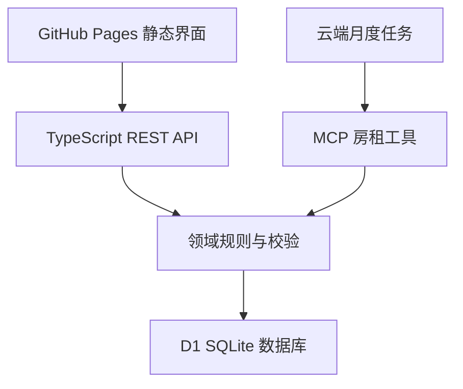

# Split · 合租共享账本

状态：实现契约 v1（2026-10-17）。前端入口：`/split/`。主站页面、导航与主题保持原样。

## 1. 产品目标与范围

为 d6 合租小组提供无需登录、公开可读写的共享账本。所有设备读取同一份服务器数据，成功保存后才显示“已同步”。支持记账、修改、回收站恢复、还款、余额与结算建议、搜索筛选、JSON 备份及 CSV 导出。读写失败保留表单草稿；并发修改必须提示冲突，不能覆盖他人的账目。

历史迁移以 `kitty_d6.xlsx` 为唯一数据源，保留日期、付款人、用途、分摊、备注和还款。验收基线：317 笔支出、27 笔还款，总支出 $35,241.21；余额 ge +$2,887.76、xu −$2,834.01、yuan $0.00、wenchao zhang −$53.75。旧账本中的 zhao 是姓名误写，统一显示为 wenchao zhang；保持原成员 ID 和历史账务归属。

### 固定预设

| 预设 | 总额 | 参与人与规则 |
| --- | --- | --- |
| Base rent | $2,125 | yuan + wenchao zhang 共 43%；wenchao zhang $840，yuan $73.75；xu 与 ge 各 28.5%，即 $605.625 |
| 水电杂费 | 手动输入 | wenchao zhang、xu、ge 三人均分 |
| 买菜 | 手动输入 | xu、ge 两人均分 |

房租默认由 ge 付款。从 2026-11 开始每月 1 日自动创建；10 月已有历史房租，不补记。时区 America/New_York。相同月份重复执行只能产生一笔；删除的自动房租不被任务重新生成。规则可暂停。具体任务启用状态和执行时间必须以部署后的云端任务为准。

### 交互约定

首页提供总支出、个人分摊、待结清金额、账目列表与还款建议。主操作始终是“记一笔”。新增流程为“选预设 → 填金额/用途 → 核对分摊 → 保存”，高级分摊选项按需展开。保存中禁用重复提交；成功有反馈；失败给出可执行的恢复动作。删除进入回收站，可恢复。还款需要核对双方与金额，不能把“建议”误当作已支付。

桌面采用侧栏和内容区；手机采用顶部导航、单列卡片与自适应表单。所有控件有文字标签，弹窗支持 Escape、键盘焦点约束，状态使用 aria-live，金额颜色配合“待收/待付”文字，不仅依靠颜色传达意义。遵循 prefers-reduced-motion。

## 2. 架构与技术栈

| 层 | 实际采用 | 可展示的后端能力 |
| --- | --- | --- |
| 前端 | 原生 ES Modules、HTML、CSS | 可部署到现有 GitHub Pages 子路径，无构建依赖 |
| API | TypeScript、Vinext 路由、Cloudflare Worker | HTTP 状态码、CORS、输入校验、错误契约 |
| 数据 | D1（SQLite）、Drizzle schema / migration | SQL 约束、参数化查询、持久化、版本迁移 |
| 一致性 | revision 乐观锁、D1 batch 事务 | 并发冲突、原子审计快照、重试 |
| 账务 | 整数分 + 高精度分摊单位 | 资金守恒、舍入、结算算法、纯函数测试 |
| 任务 | 云端调度 + MCP 调用 | 时区、幂等、失败重试、漏跑补记 |
| 工程 | Node test runner、API 集成测试、GitHub Actions | 回归测试、CI、部署与运维记录 |

前端托管于 GitHub Pages；后端托管于独立的 Sites/Worker 服务。GitHub Pages 本身不能执行服务器代码，因此只发布静态界面。数据库不放在 localStorage。浏览器仅可存个人显示偏好；共享账目以服务器为准。

## 3. 数据设计

`books(id PK, document TEXT, revision INTEGER, updated_at TEXT)` 存账本聚合；`book_history(id PK, book_id, document, revision, created_at)` 存每次修改前的快照。document 是经过服务端规范化校验的版本化 JSON，包含 members、entries、rentRule。entry 包含稳定 ID、类型、日期、付款人、收款人、金额、分摊、备注及软删除时间。

选择一个账本作为事务边界：本项目 344 条历史记录、4 位成员，整本读取便于导入导出与校验。写入上限 10,000 条、请求 4 MB。不把 JSON 文档包装成大规模关系分析平台；如需要跨账本报表、海量记录与局部写入，下一版应拆出 members / entries / allocations 表，并增加分页查询。本版的 SQL 数据库、事务、迁移与持久化是真实运行的。

金额 amountCents 是整数分；shares 是每分 1,000,000 单位的整数（microcent），保留 Kittysplit 原有小数分摊。每笔 shares 之和必须等于 amountCents × 1,000,000。所有人的净余额先聚合后舍入到分；再确定性调整尾差，保证余额总和等于零。房租的半分钱不会在记账时凭空多出一分钱。结算建议采用最大债权/债务逐次匹配，减少转账数量，但不声称全局最少。

## 4. API 与一致性契约

完整机器可读契约见 `openapi.json`。

| 路由 | 行为 | 关键响应 |
| --- | --- | --- |
| GET /api/books/{id} | 读取账本和 revision | 200 / 404 / 503 |
| POST /api/books | 创建新账本 | 201 / 400 / 409 |
| PUT /api/books/{id} | 传 book + 读取时的 revision | 200 / 400 / 409 |
| GET /api/health | 数据库连通性 | 200 / 503 |
| GET /api/rent | 读取房租规则和到期月份，不写入 | 200 / 503 |
| POST /api/rent | 应用服务器时钟下已到期房租 | 200 / 400 / 503 |
| POST /mcp | 提供只读汇总和 apply_due_rent 工具 | JSON-RPC |

更新事务先在同一 revision 条件下写入历史，再更新当前记录；若修改行数为 0，返回 409。客户端不自动用旧快照重试覆盖。普通编辑由用户刷新后保留字段重试；定时任务重新读取最新版本、重算新增月份、最多尝试 5 次。每月记录 ID 为 `rent-YYYY-MM`，重复运行、网络重试、任务补跑均幂等。若该月已有同额房租则跳过，防止手工提前记账与任务重复。

公开编辑是产品需求，CORS 只是浏览器来源限制，不是身份验证。所有人均可查看、修改、导出账本。参数化 SQL、防止 HTML 注入、金额及 ID 校验、CSV 公式转义是基础正确性措施。没有把数据库凭据或仓库写入令牌放到前端。审计快照记录版本变化，不声称能识别匿名操作者。

## 5. 测试与验收

- 迁移数据逐人余额与 Excel 一致；历史 344 条完全保留。
- 均分、自定义金额、比例、份数、收入、还款、软删除与恢复；每笔分摊守恒、总余额为零。
- 房租规则正确；月界线以纽约时区判断；重复调用不重复，暂停不入账，删除不重建，漏跑按月补记。
- 两个客户端用同 revision 保存：一个成功，一个 409；旧版本历史快照与新版本原子保存。
- 无效金额、未知参与人、重复 ID、原型键、过大请求、坏日期均被拒绝。
- 桌面与手机查看、新增、编辑、删除/恢复、还款、搜索和导出可用；测试数据放独立账本，历史账本不产生测试流水。
- GitHub 提交仅涉及 split/ 及独立 CI 工作流；主站首页内容不变。
- 实际生产地址能访问；云端任务保存成功、写入工具经过无副作用验证后才宣称自动入账已启用。

## 6. 展示路线（5 分钟）

1. 演示从 Excel 迁移与逐人对账，说明为何不能每条先四舍五入。
2. 用水电预设新增一笔，展示服务器共享与保存反馈。
3. 两个浏览器同时编辑，展示 409 如何保护他人更新。
4. 展示月度房租幂等测试、时区边界和漏跑补记。
5. 打开 API 契约、数据迁移与 CI，说明聚合存储的取舍及扩展路径。

## 7. 部署与运维

前端配置在 `config.mjs`，将静态文件原样放到仓库 split/。后端源代码镜像在 `project/backend/`，通过 Sites 工作流部署；D1 迁移随版本应用。环境配置与令牌不提交。开发预览使用托管预览服务和本地 D1。

部署后检查健康接口、d6 账目计数/余额、CORS、两端浏览器展示，并读取云端任务状态。后端保留每次写入前快照；用户可导出 JSON 备份。回滚代码不等于回滚数据库。恢复数据前先导出当前版本，再用带 revision 的写入执行受控恢复。运行日志应记录请求路径、结果和耗时，不记录完整账本或凭据。

后续可独立扩展 Postgres、条目级 REST、身份权限、队列与缓存；这些不列为本版已实现能力。先保持本项目的小规模使用体验与可核验实现。

## 参考资料

- [GitHub Pages 的静态托管范围](https://docs.github.com/en/pages/getting-started-with-github-pages/what-is-github-pages)
- [Cloudflare D1 的数据库与 batch API](https://developers.cloudflare.com/d1/worker-api/d1-database/)
- [Drizzle Kit 迁移生成](https://orm.drizzle.team/docs/drizzle-kit-generate)
